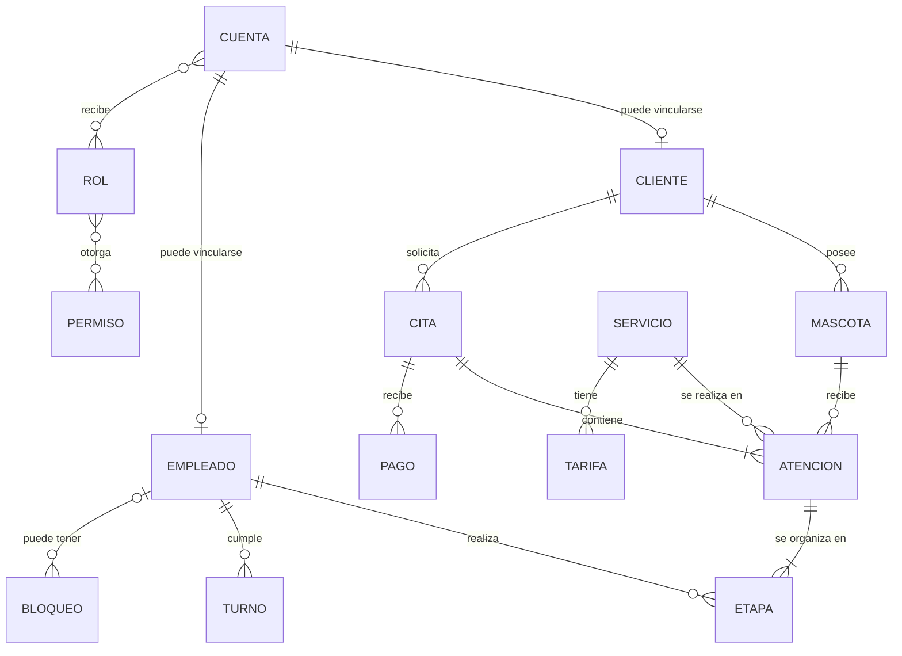
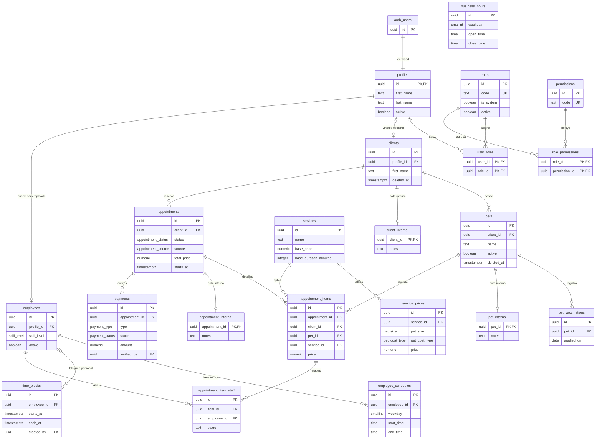

# Actividad 1 — Modelo de datos y trazabilidad

Versión documental: v1. Fecha de corte: 2026-10-20 (America/Lima). Preparado a partir del [modelo local](../Pandas11.sql), las migraciones versionadas y las reglas de negocio. Requiere revisión y aceptación del negocio como entregable académico. No acredita el esquema remoto ni sustituye una migración.

## 1.1 Requerimientos y alcance

El levantamiento disponible consta en [misión](mission.md), [reglas de negocio](business-rules.md) y requisitos por fase. Estas fuentes permiten describir clientes, mascotas, servicios, trabajadores, turnos, citas y cobros. El usuario indicó que Alex y Caro, dueños del negocio, asistieron a la reunión inicial, pero desconoce la fecha. La [plantilla de acta](actividad-1-acta-plantilla.md) registra ese dato y mantiene pendientes los acuerdos y la conformidad formal.

## 1.2 ERD conceptual v1, reconstruido

Este diagrama resume conceptos del negocio. **v1 reconstruido** significa primera representación documental elaborada a partir del modelo existente; no afirma haber sido el diagrama histórico que se usó en S1.

`ATENCION` corresponde a `appointment_items` y `ETAPA` a `appointment_item_staff`. `BLOQUEO` puede afectar a un empleado o a todo el local; el caso global usa `employee_id` nulo. `CUENTA` corresponde a Supabase Auth más `profiles`. La cardinalidad de al menos una atención/etapa refleja el contrato de la agenda operativa; la base por sí sola permite estados intermedios durante una transacción.

## 1.3 Entorno y repositorio

Hay evidencia de un repositorio Git local, [configuración Supabase local](../supabase/config.toml), [guía de uso](../supabase/README.md) y migraciones. El usuario proporcionó un [enlace al proyecto Supabase](https://supabase.com/dashboard/project/slqhtaceprjwlwlzplnj) y un [enlace al repositorio GitHub](https://github.com/jafetmendozac/Pandas11_software-system). La URL de GitHub coincide con `origin` en la configuración Git local; no se inspeccionó el contenido remoto ni se verificó el acceso al panel Supabase. Para cerrar 1.3 faltan fecha de creación y constancias verificables apropiadas para el informe; no incluir claves ni datos privados.

## 1.4 ERD físico vigente en migraciones locales

El diagrama siguiente representa las 21 tablas creadas por migraciones en el repositorio. Muestra claves y columnas que explican relaciones; el [diccionario](actividad-1-diccionario-datos.md) recoge **todas** las columnas. `auth_users` es la tabla externa de Supabase Auth. La presencia de una migración indica definición versionada y validación local registrada en las fases, no confirma un despliegue remoto.

Relaciones adicionales que se omiten del dibujo para conservar legibilidad, pero constan en el SQL: `time_blocks.created_by`, `client_internal.updated_by`, `pet_internal.updated_by`, `appointment_internal.updated_by`, `appointments.created_by`, `appointments.cancelled_by`, `payments.created_by` y `payments.verified_by` apuntan a `profiles.id`. `appointment_items(appointment_id,client_id)` apunta a `appointments(id,client_id)` y `appointment_items(pet_id,client_id)` a `pets(id,client_id)`; esas claves compuestas impiden mezclar mascotas de otro cliente. `business_hours` no tiene FK: define horario semanal global.

### Áreas previstas solo en el modelo local

| Tabla | Propósito descrito por `Pandas11.sql` | Estado |
|---|---|---|
| `business_settings` | Configuración general clave–valor | Sin CREATE TABLE en migraciones disponibles. |
| `billing_documents` | Cabecera de documento de facturación | Sin CREATE TABLE en migraciones disponibles. |
| `billing_document_items` | Detalles de documento | Sin CREATE TABLE en migraciones disponibles. |
| `notifications` | Comunicaciones programadas y enviadas | Sin CREATE TABLE en migraciones disponibles. |
| `audit_log` | Cambios por actor/entidad | Sin CREATE TABLE en migraciones disponibles. |

No aparecen tablas propias de ventas mixtas, productos, inventario, movimientos de stock o caja en las migraciones revisadas. No se agregan al ERD físico operativo por estar en la planificación del cronograma, pendiente de especificación.

## 1.5 Ajustes según pruebas de seguridad

El [informe de revisión inicial](features/revision-modelo-base-datos/review.md) es histórico: documenta H-01/H-02 antes de su corrección. Su [validación](features/revision-modelo-base-datos/validation.md) confirma coma en `appointments.pickup_fee` y eliminación de FKs duplicadas en el archivo local. Las migraciones posteriores introdujeron restricciones, RLS y funciones para identidades, fichas, servicios, empleados, agenda y pagos. Esto se refleja en las claves/estados del ERD físico y en los campos obligatorios del diccionario.

| Ajuste o control | Tablas/relaciones afectadas | Evidencia |
|---|---|---|
| Alta de cuenta con perfil y roles asignables solo por lógica autorizada | `auth.users`, `profiles`, `user_roles`, `roles`, `role_permissions` | [Migración y validación Fase 0](features/fase-0-fundamentos-seguridad/validation.md). |
| Propiedad y separación de notas internas | `clients`, `pets`, `client_internal`, `pet_internal` | [Validación Fase 1](features/fase-1-clientes-mascotas/validation.md). |
| Reglas tarifarias y unicidad con comodines | `services`, `service_prices` | [Validación Fase 2](features/fase-2-servicios-precios/validation.md). |
| Turnos, habilidades y bloqueos con permisos | `employees`, `employee_schedules`, `business_hours`, `time_blocks` | [Validación Fase 3](features/fase-3-empleados-disponibilidad/validation.md). |
| Detalle de cita ligado al mismo cliente, etapas y conflictos concurrentes | `appointments`, `appointment_items`, `appointment_item_staff` | [Validación Fase 4](features/fase-4-agenda-reservas-internas/validation.md). |
| Cobros con idempotencia y verificación exclusiva del propietario | `payments`, `appointments` | [Validación Fase 5](features/fase-5-pagos-adelantos/validation.md). |

El ERD físico representa relaciones y claves; RLS, roles y reglas de concurrencia se documentan en las migraciones y pruebas. La revisión inicial enumera H-03 a H-23; cada punto requiere comparación individual con el estado actual antes de declararlo resuelto. Este documento no declara resueltos en bloque esos hallazgos ni certifica una base remota.

## Pendientes de cierre académico

1. Añadir fecha, asistentes y conformidad de la reunión inicial; revisar el ERD conceptual reconstruido con el negocio.
2. Adjuntar constancias del proyecto Supabase y repositorio GitHub cuyos enlaces aportó el usuario, junto con fecha de creación si se dispone de ella. Verificar acceso/propiedad antes de presentarlos como hechos comprobados externamente.
3. Aceptar la versión física y el [diccionario de datos](actividad-1-diccionario-datos.md) como representación del modelo local; decidir si el informe necesita diagrama gráfico exportado y anexarlo.
4. Para 1.5, relacionar hallazgos adicionales con pruebas concretas solo después de contrastarlos; conservar los límites de las pruebas locales.
